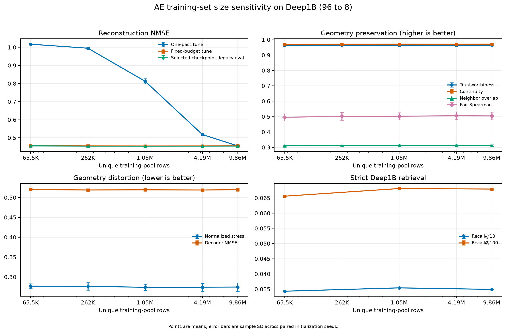

# Autoencoder training-set-size sensitivity on Deep1B

## Result

For this fixed Deep1B reduction at 1,204 updates, the apparent one-pass sample-size effect is
strongly confounded by optimizer exposure: one pass over a larger pool also performs more
updates. When every arm receives the same
1,204 updates and the same 9,863,168 row presentations, increasing the number of *distinct*
training rows from 65,536 to 9,863,168 changes legacy-evaluation NMSE by only 0.000918 (0.20%
relative). The response is small and non-monotone across the intermediate pool sizes.

This is a short-budget result, not a general sufficiency claim. The companion tune-only
update-budget study finds continued improvement through 9,632 updates and descriptively lower
terminal NMSE for the one-million-row pool than for the 65,536-row pool, without fresh-seed
legacy confirmation. It does not establish that an autoencoder elbow, another corpus, or a
different model is sample-size invariant.



## Controlled protocol

- Source: the fixed 10,000,000-row Deep1B prefix, with 96 float32 coordinates per row.
- Model: symmetric 96-256-128-32-8 autoencoder with 124,328 parameters.
- Objective: elementwise reconstruction MSE; AdamW at learning rate 0.001 and weight decay
  0.00001; deterministic CUDA FP32.
- Splits: a new 65,536-row tuning set, the fixed 65,536-row legacy evaluation cohort, and five
  nested uniformly shuffled training pools. The three sets are exactly disjoint.
- Pool sizes: 65,536; 262,144; 1,048,576; 4,194,304; and 9,863,168 rows.
- Control: batch size 8,192 and exactly 1,204 optimizer updates per arm, hence 9,863,168 row
  presentations regardless of pool size.
- Replication: three paired initialization seeds, 1729--1731. Every pool size starts from the
  same initial weights within a seed.
- Selection: tuning NMSE evaluated on a common 32-update grid, with the final update included.
  The legacy evaluation cohort is used only after tune-only checkpoint selection.
- NMSE: reconstruction MSE divided by the MSE of predicting the evaluation cohort's featurewise
  mean. Cosine is the mean rowwise input/reconstruction cosine similarity.

The legacy cohort is the same fixed cohort used in the earlier Deep1B study. It is disjoint from
all training and tuning rows in this experiment, but it should be read as a legacy evaluation
set rather than as a never-before-seen final test set.

## Reconstruction

Values are mean plus or minus sample standard deviation across the three paired initialization
seeds.

| Distinct training rows | Equivalent passes at fixed budget | One-pass tune NMSE | Fixed-budget tune NMSE | Selected-checkpoint legacy NMSE | Legacy cosine |
|---:|---:|---:|---:|---:|---:|
| 65,536 | 150.500 | 1.017150 +/- 0.001950 | 0.455859 +/- 0.002000 | 0.455139 +/- 0.001775 | 0.750850 +/- 0.001167 |
| 262,144 | 37.625 | 0.995002 +/- 0.005249 | 0.454802 +/- 0.001671 | 0.453835 +/- 0.001606 | 0.751768 +/- 0.001191 |
| 1,048,576 | 9.406 | 0.812281 +/- 0.014316 | 0.454496 +/- 0.002194 | 0.453661 +/- 0.002030 | 0.751820 +/- 0.001441 |
| 4,194,304 | 2.352 | 0.517816 +/- 0.000799 | 0.454657 +/- 0.002275 | 0.453808 +/- 0.002078 | 0.751820 +/- 0.001456 |
| 9,863,168 | 1.000 | 0.455074 +/- 0.002353 | 0.455074 +/- 0.002353 | 0.454221 +/- 0.002272 | 0.751468 +/- 0.001654 |

The one-pass curve falls from 1.0172 to 0.4551, but the one-pass update count simultaneously
rises from 8 to 1,204. Under the common budget, all five legacy NMSE means lie between 0.45366
and 0.45514. The best checkpoint is the final update in all 15 arms, so even the smallest pool
does not show tune-set overtraining within this budget despite being recycled 150.5 times.

For the smallest-versus-largest paired contrast, legacy NMSE is 0.000918 higher for the 65,536
pool, while cosine is 0.000617 lower. These differences are smaller than the observed
initialization-seed variation. With only three paired seeds, they are descriptive rather than a
high-powered equivalence test.

## Geometry and retrieval checks

Geometry was evaluated for all 15 selected checkpoints on fixed subsets of the same legacy
cohort. The endpoint differences are also small.

| Metric | 65,536 rows | 9,863,168 rows | Small minus large |
|---|---:|---:|---:|
| Trustworthiness (higher is better) | 0.961596 | 0.962922 | -0.001326 |
| Continuity (higher is better) | 0.970619 | 0.971074 | -0.000454 |
| Neighbor overlap at 16 (higher is better) | 0.310258 | 0.311429 | -0.001171 |
| Pair-distance Spearman (higher is better) | 0.495479 | 0.504335 | -0.008856 |
| Normalized stress (lower is better) | 0.276823 | 0.274620 | +0.002203 |
| Local-decoder NMSE (lower is better) | 0.519898 | 0.519588 | +0.000310 |

Strict Deep1B original-ID retrieval was run for seed 1729 only, so these values are a
descriptive spot check rather than a replicated result.

| Distinct training rows | Recall@10 | Recall@100 |
|---:|---:|---:|
| 65,536 | 0.0343 | 0.06558 |
| 1,048,576 | 0.0354 | 0.06810 |
| 9,863,168 | 0.0349 | 0.06793 |

The retrieval result is likewise nearly flat. It also reiterates the earlier finding that a
plain MSE autoencoder has weak strict neighbor-ID recall at width eight; changing training-pool
size does not repair that limitation.

## Interpretation

The practical conclusion at 1,204 updates is that reusing about 65,000 representative unique
examples reaches nearly the same reconstruction and broadly the same geometry as nearly 10
million unique examples. The earlier one-pass contrast cannot be interpreted as a distinct-row
effect because one pass over more rows also meant more optimization. This statement must not be
extrapolated to longer training: in the separately predeclared tune-only update-budget study,
the one-million-row pool ends with better tune metrics than the 65,536-row pool at 9,632
updates, but that separation has no fresh-seed legacy confirmation.

Important limits are:

- only one fixed nested draw of the training pools was tested;
- reconstruction and geometry use three initialization seeds, while retrieval uses one seed and
  only three selected pool sizes;
- the experiment fixes the bottleneck at eight and therefore does not measure the stability of
  the reconstruction-error elbow itself;
- Deep1B image descriptors need not behave like arXiv or Wikipedia embeddings; and
- a larger model, stronger regularization, or structure-aware loss could expose another
  data-diversity regime; the companion longer-budget study already exposes one interaction
  within this architecture.

## Reproduction and artifacts

The controlled training run is reproduced with:

```bash
python experiments/compare_ae_training_sizes.py \
  --data /path/to/deep-base-prefix-10m.fbin \
  --device cuda \
  --output-dir artifacts/deep1b-ae-training-size \
  --checkpoint-dir artifacts/deep1b-ae-training-size/checkpoints
```

The selected-checkpoint geometry evaluation is reproduced with:

```bash
python experiments/evaluate_ae_training_size_geometry.py \
  --results artifacts/deep1b-ae-training-size/results.json \
  --checkpoint-dir artifacts/deep1b-ae-training-size/checkpoints \
  --data /path/to/deep-base-prefix-10m.fbin \
  --output-dir artifacts/deep1b-ae-training-size/geometry
```

`encode_ae_training_size_checkpoint.py` streams a selected checkpoint over the common Deep1B
base and query sets; `evaluate_ae_training_size_retrieval.py` computes several strict recall
cutoffs from one exact search per arm. `analyze_ae_training_size_results.py` joins the compact
training, geometry, and retrieval packages and regenerates this directory's public-safe tables
and figures.

The tracked artifacts are:

- `training-results.csv`: per-arm reconstruction and timing results;
- `geometry-results.csv`: per-arm geometry results;
- `retrieval-results.csv`: selected-arm strict retrieval results;
- `aggregate.csv`: means and sample standard deviations by pool size;
- `paired-contrasts.csv`: within-initialization contrasts against the largest pool;
- `summary.json`: machine-readable, path-free analysis and provenance;
- `learning-curves.png` and `learning-curves.pdf`: the four-panel summary figure.

Full checkpoints and 10-million-row encoded layouts are intentionally not tracked.
