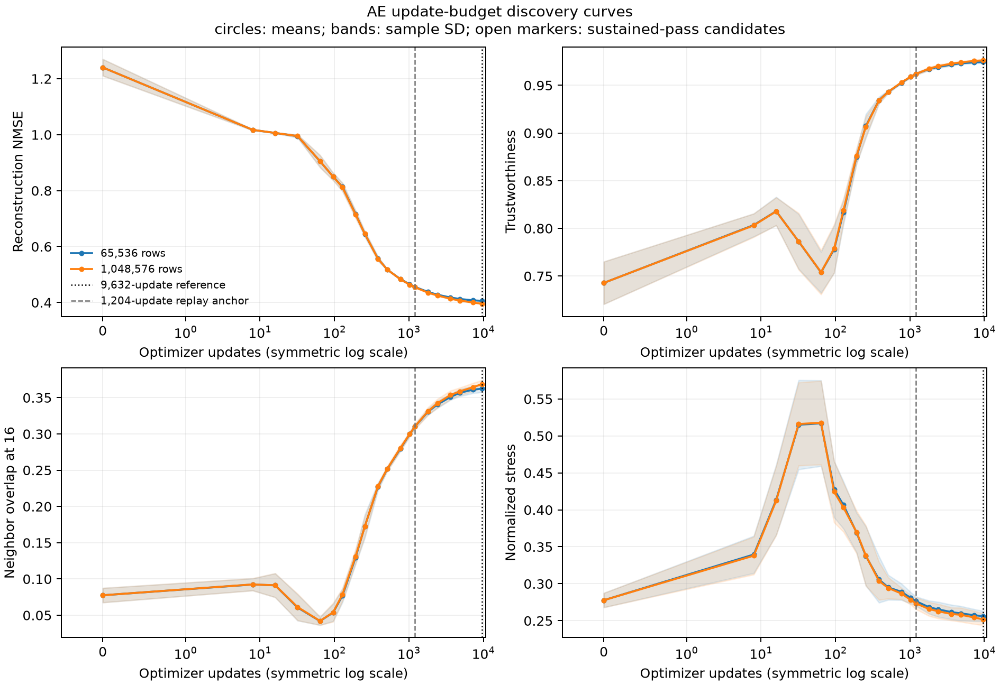

# Autoencoder optimizer-update sensitivity on Deep1B

## Result

No qualifying plateau was observed under the frozen tune-NMSE rule through 9,632 updates, and
the predeclared procedure found no earlier budget that could be advanced to fresh-seed
confirmation. The earlier 1,204-update run was therefore not merely paying unnecessary compute:
reconstruction and most geometry metrics continued to improve substantially with longer
training.

This is a negative stopping-rule result, not a failed run. The tune-only discovery, protocol
binding, and exact 1,204-update replay all passed. Fresh-seed legacy-cohort confirmation and
retrieval were intentionally not run because no discovery candidate satisfied the frozen gate.

## Design

- Task: Deep1B 96-to-8 reduction with the same symmetric 96-256-128-32-8 MSE autoencoder,
  AdamW optimizer, batch size 8,192, and deterministic CUDA FP32 protocol used in the
  training-set-size study.
- Pools: 65,536 rows as the primary case and 1,048,576 rows as a separately analyzed robustness
  case.
- Discovery seeds: 1729, 1730, and 1731.
- Discovery cohort: the disjoint 65,536-row tune cohort only. The fixed legacy cohort was not
  materialized.
- Updates: 0, 8, 16, 32, 64, 96, 128, 192, 256, 384, 512, 768, 1,024, 1,204,
  1,808, 2,408, 3,612, 4,816, 7,224, and 9,632.
- Geometry: fixed tune-cohort subsets of 5,000 rows for rank metrics, 10,000 rows for local
  decoding, and 200,000 sampled pairs.
- Frozen protocol SHA-256: `41db717aade5062028efd9a7e3d8d57ca238a1f06c781aaf54b06b87deea89a0`.
- Replay: all six update-1,204 model-state hashes and tune reconstruction metrics matched the
  earlier training-size experiment exactly.

Signed degradation was measured against the terminal checkpoint within the same seed and pool.
The practical non-inferiority margins were 1% relative for reconstruction and local-decoder
NMSE; 0.005 for reconstruction cosine, neighbor overlap, and stress; 0.002 for trustworthiness
and continuity; and 0.010 for pair-distance Spearman. An early candidate also needed two later
passing checkpoints. These are engineering tolerances, not universal equivalence bounds.

## Learning curves

Values are means across the three paired initialization seeds. Optimizer time excludes geometry
evaluation.

| Pool | Updates | Optimizer time (s) | Tune NMSE | Trustworthiness | Neighbor overlap | Stress | Local-decoder NMSE |
|---:|---:|---:|---:|---:|---:|---:|---:|
| 65,536 | 1,204 | 4.50 | 0.45586 | 0.96195 | 0.31015 | 0.27640 | 0.52477 |
| 65,536 | 4,816 | 17.77 | 0.41269 | 0.97306 | 0.35670 | 0.25991 | 0.50224 |
| 65,536 | 7,224 | 26.56 | 0.40784 | 0.97398 | 0.36096 | 0.25748 | 0.49975 |
| 65,536 | 9,632 | 35.38 | 0.40596 | 0.97433 | 0.36244 | 0.25611 | 0.49872 |
| 1,048,576 | 1,204 | 4.50 | 0.45450 | 0.96189 | 0.31020 | 0.27348 | 0.52327 |
| 1,048,576 | 4,816 | 17.72 | 0.40721 | 0.97404 | 0.35862 | 0.25801 | 0.50008 |
| 1,048,576 | 7,224 | 26.53 | 0.39995 | 0.97548 | 0.36435 | 0.25449 | 0.49680 |
| 1,048,576 | 9,632 | 35.33 | 0.39564 | 0.97613 | 0.36872 | 0.25176 | 0.49505 |

Relative to update 9,632, stopping at 1,204 makes tune NMSE approximately 12.3% worse for the
65K pool and 14.9% worse for the 1M pool while using one eighth of the optimizer time. Stopping
at 4,816 still leaves NMSE about 1.7% and 2.9% worse, respectively, outside the frozen 1% margin.

At update 7,224, the 65K pool passes every pointwise degradation margin relative to 9,632, while
the 1M pool's paired reconstruction degradation is about 1.08%, just outside the 1% margin.
Neither can be selected under the frozen sustained-pass rule because only one later checkpoint
remains and the terminal region is not flat.

## Why this is not yet a plateau

The frozen terminal criterion required mean absolute paired NMSE change of at most 0.25% on each
of the final two intervals. The observed changes were:

| Pool | 4,816 to 7,224 | 7,224 to 9,632 |
|---:|---:|---:|
| 65,536 | 1.174% | 0.462% |
| 1,048,576 | 1.783% | 1.077% |

Both pools therefore fail the reconstruction flatness rule even after the single predeclared
extension. Most geometry changes on the final interval are already small, but reconstruction is
still improving too quickly to call 9,632 an established endpoint. The protocol consequently
reports “no qualifying plateau under the frozen tune-NMSE rule through 9,632” and issues no
recommended stopping budget.

The long run also shows a descriptive tune-cohort pool-by-budget separation. The 65K and 1M
pools are nearly tied at 1,204 updates, but at 9,632 the 1M pool has lower NMSE (0.39564 versus
0.40596), higher neighbor overlap (0.36872 versus 0.36244), and lower stress (0.25176 versus
0.25611).
Thus the earlier finding that 65K and larger pools were nearly tied is specific to the shorter
optimization budget. At the longer tune-only budget, the larger pool has descriptively better
metrics, but that separation has not been tested on fresh seeds or the legacy cohort.

## Compute interpretation

The complete 9,632-update optimizer phase takes about 35 seconds per trajectory on the GH200;
1,204 updates take about 4.5 seconds. The eightfold theoretical update saving is real, but its
absolute value on this GPU is only about 31 seconds and comes with measurable reconstruction and
geometry degradation. The entire discovery run took 578 seconds because it evaluated fixed
geometry samples at every checkpoint; that diagnostic overhead is not part of normal model
training.

This study therefore does not justify replacing the long reference with a shorter stopping rule
if the longer-run quality is desired. It also shows that the earlier 1,204-update configuration
was still under-optimized under these metrics. It does not establish that 9,632 is the optimal
budget: the curve was still improving at the cap. A future extension could locate a later
practical plateau, but it would be a new predeclared experiment rather than an outcome-driven
continuation of this one.

## Artifacts

- `protocol.md`: the audit-approved protocol frozen before production.
- `discovery-results.csv`: per-seed, per-pool checkpoint metrics and timing.
- `replay-verification.json`: public-safe exact replay audit.
- `aggregate.csv`: means and sample standard deviations.
- `paired-degradation.csv`: within-seed degradation relative to update 9,632.
- `candidate-decisions.csv`: pointwise and sustained-pass decisions plus optimizer speedups.
- `terminal-slope.csv`: paired terminal changes and flatness checks.
- `replay-anchor.csv`: update-1,204 versus terminal-reference diagnostics.
- `summary.json`: machine-readable decision and provenance summary.
- `update-budget-curves.png` and `update-budget-curves.pdf`: discovery curves.

Full source paths, model checkpoints, and encoded layouts are intentionally not tracked.
